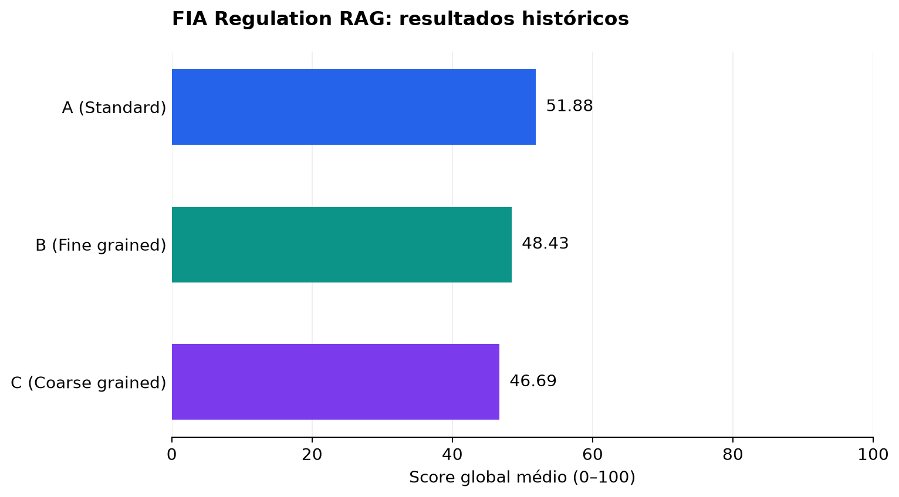

# FIA Regulation RAG

**Perguntas em português sobre os regulamentos de Fórmula 1 de 2026, com recuperação de evidências e avaliação automatizada por LLM.**

Projeto da disciplina de **Inteligência Artificial da Universidade Federal de Campina Grande (UFCG)**, com o **Prof. Herman Martins Gomes**, encerrado em **05 de março de 2026**. Esta versão reúne o notebook do trabalho e adaptações posteriores para execução local e apresentação em portfólio.

[Apresentação no Canva](https://canva.link/awqly4iidizn969) · [Notebook](FIA_Regulation_RAG.ipynb) · [Resultados e limitações](results/README.md) · [Google Colab com execução original](https://colab.research.google.com/drive/1yZ3uLqYBmWNSciBQEIDrdaMXlu_8RUdU?usp=sharing) · [Créditos](NOTICE.md)

## Autores

| Autor | GitHub |
| --- | --- |
| Arthur Félix | [@ArthurHappx](https://github.com/ArthurHappx) |
| Maria Clara | [@claraugusta](https://github.com/claraugusta) |
| Luis Alberto | [@Luisprog1](https://github.com/Luisprog1) |
| Emmily Almeida | [@EmmilyNeri](https://github.com/EmmilyNeri) |
| Gledson Luan | [@GledsonLScruz](https://github.com/GledsonLScruz) |

## Problema e abordagem

Regulamentos extensos exigem localizar artigos, relacionar cláusulas e justificar a resposta. O projeto investiga como a granularidade do pré-processamento afeta um sistema de *Retrieval-Augmented Generation* (RAG) aplicado às seções A (General), B (Sporting), C (Technical) e F (Operational) dos regulamentos FIA de 2026.

O fluxo traduz a pergunta de português para inglês com DeepL, recupera documentos em índices FAISS, reordena os candidatos com um cross-encoder e fornece os trechos selecionados a um LLM. O prompt pede respostas técnicas em português, com referências ao contexto, e abstenção quando faltam evidências.

| Estratégia | Unidade de recuperação |
| --- | --- |
| A (Standard) | Markdown com chunks de 1.200 caracteres e sobreposição de 150 |
| B (Fine grained) | Itens estruturados em JSONL com metadados |
| C (Coarse grained) | Cláusulas extraídas dos arquivos Markdown com metadados |
| Sem RAG | Pergunta enviada ao modelo sem recuperação; ver ressalvas sobre o experimento histórico |

**Tecnologias:** Python, Jupyter, LangChain, Sentence Transformers, FAISS, DeepL, NVIDIA NIM, pandas e Matplotlib. Os embeddings usam `sentence-transformers/all-MiniLM-L6-v2`; o reranking usa `cross-encoder/ms-marco-MiniLM-L-6-v2`.

## Resultados do trabalho

Os quatro CSVs históricos contêm 100 perguntas por método. A avaliação usa cinco critérios inspirados no [CCRS, de Aashiq Muhamed (2025)](https://arxiv.org/abs/2506.20128): coerência contextual, relevância, densidade de informação, corretude e recall. O score global usa pesos definidos pelo projeto.



| Método RAG | Score global médio | Corretude média | Recall médio |
| --- | ---: | ---: | ---: |
| A (Standard) | 51,883 | 42,67 | 40,45 |
| B (Fine grained) | 48,428 | 38,53 | 36,16 |
| C (Coarse grained) | 46,690 | 38,55 | 34,74 |

O método A apresentou a maior média neste conjunto. As notas foram atribuidas, usando LLM-as-a-Judge, em escala de 0–100, **não porcentagens de acerto**. A vantagem média foi de 3,455 pontos sobre B e 5,193 sobre C; os intervalos exploratórios por bootstrap pareado incluem zero. Esses resultados não permitem afirmar superioridade geral de uma estratégia. A [análise detalhada](results/ANALYSIS.md) apresenta medidas, exemplos, incertezas e propostas de experimentos.

As [notas por pergunta, médias e hashes das fontes](results/historical/) permitem inspecionar os resultados sem chaves de API. Respostas completas e trechos dos regulamentos permanecem locais.

## Executar localmente

Ambiente validado: **Windows, Python 3.12 e CPU**. As instruções abaixo incluem Linux com Bash, mas a instalação e a execução nesse sistema ainda não foram validadas.

**Windows / PowerShell**

```powershell
python --version  # use Python 3.12
python -m venv .venv
.\.venv\Scripts\python.exe -m pip install -r requirements-lock.txt
Copy-Item .env.example .env
```

**Linux / Bash**

```bash
python --version
python -m venv .venv
./.venv/bin/python -m pip install -r requirements.txt
[ -f .env ] || cp .env.example .env
```

`requirements-lock.txt` registra as versões instaladas no Windows validado e inclui `pywinpty`, específico desse sistema; não o use diretamente no Linux. `requirements.txt` contém faixas de dependências e permite resolver pacotes para a plataforma de destino. As versões resolvidas no Linux podem diferir das versões do lock e precisam de validação.

Preencha `NVIDIA_API_KEY` e `DEEPL_API_KEY` no `.env`. As variáveis `NVIDIA_MODEL` e `NVIDIA_JUDGE_MODEL` permitem trocar os modelos. Os padrões atuais são `nvidia/nemotron-3.5-lightning-30b-a3b` e `openai/gpt-oss-20b`, testados com chamadas reais em **29/10/2026**. A disponibilidade de endpoints pode mudar.

Abra o notebook no VS Code com as extensões Python e Jupyter. Em **Select Kernel → Python Environments**, selecione `.venv/Scripts/python.exe` no Windows ou `.venv/bin/python` no Linux. Alternativamente, inicie o JupyterLab:

**Windows / PowerShell**

```powershell
.\.venv\Scripts\python.exe -m jupyterlab
```

**Linux / Bash**

```bash
./.venv/bin/python -m jupyterlab
```

Execute as células em ordem até a seção **12. Execução rápida**. A primeira configuração baixa os dados do repositório [filesIAColab](https://github.com/GledsonLScruz/filesIAColab) na revisão `b7fc835a3ebd080a919aa3cc8a531c667b7e90a2`. Pastas de dados já existentes são conferidas, sem sobrescrever alterações locais. Na primeira execução, os modelos são baixados e três índices FAISS são criados; esse processamento pode levar vários minutos em CPU.

O `.env` é carregado sem substituir variáveis já definidas no processo. Após alterar chaves ou modelos, reinicie o kernel e execute as células novamente. Tradução, geração e avaliação enviam perguntas, trechos recuperados e respostas aos serviços correspondentes e podem consumir cota ou créditos.

### Avaliação e análise

`RUN_EVALUATIONS = False` evita iniciar os lotes de avaliação ao usar **Run All**. Os exemplos das seções anteriores ainda fazem chamadas de tradução e geração. Para avaliar, altere para `True` e execute os lotes desejados. A avaliação completa executa até 100 perguntas por método, com cinco chamadas de juiz por resposta, além de geração e tradução.

Novas execuções geram `avaliacao_a.csv`, `avaliacao_b.csv`, `avaliacao_c.csv` e `avaliacao_noRAG.csv`, acompanhados de metadados da configuração. A análise do notebook usa esses quatro arquivos em conjunto. As notas históricas publicadas ficam separadas em `results/historical/`; elas não são substituídas ao executar o notebook.

## Limitações e manutenção

- O conjunto de referência contém perguntas sintéticas com revisão manual; não substitui uma avaliação independente de especialistas.
- Juízes LLM podem produzir notas inconsistentes e compartilham vieses com modelos geradores. A adaptação ao domínio FIA não é uma replicação integral dos experimentos do artigo CCRS.
- Tradução, tamanho dos chunks, truncamento de embeddings e seleção de contexto influenciam a recuperação. O sistema não garante respostas corretas nem reflete automaticamente versões posteriores dos regulamentos.

## Organização e publicação

```text
FIA_Regulation_RAG.ipynb    # Pipeline, exemplos e análise de novas avaliações
results/historical/         # Notas históricas, médias, proveniência e figura
scripts/                    # Exportação de notas, figura e verificação de publicação
requirements*.txt           # Dependências e versões do ambiente validado
.env.example                # Configurações sem credenciais
NOTICE.md                   # Autoria, referências e materiais de terceiros
```

Essa verificação inspeciona os arquivos que o Git incluiria e procura credenciais e saídas de notebook. Ela não publica arquivos. O código autoral está sob a [licença MIT](LICENSE); os materiais de terceiros seguem as condições de seus titulares, conforme [NOTICE.md](NOTICE.md). Projeto acadêmico independente, sem vínculo oficial com a FIA ou a Formula 1.
